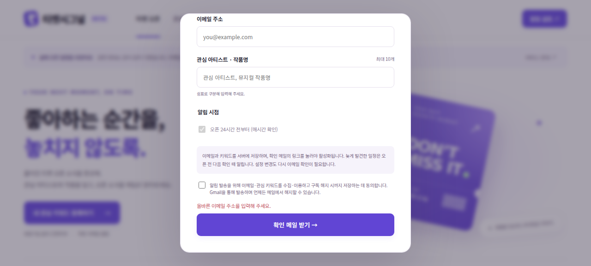

# 실제 이메일 알림

## 사용자 흐름

이메일·관심 키워드(2~40자, 최대 10개)·동의를 입력하면 확인 메일을 보낸다. 링크를 열고 확인 버튼을 눌러야 서버 구독이 활성화된다. 확인 링크는 24시간 유효하며, 설정 변경도 재확인 후 적용한다. 기존 브라우저 데모는 자동으로 구독하지 않는다.

매시간 실행할 소유자 도구 `send_due_ticket_alerts`는 현재부터 24시간 내 열리는 일정을 확인하고 키워드가 맞는 확인된 구독자에게 보낸다. 뒤늦게 발견·등록한 일정도 오픈 전에 안내한다. 같은 공연의 같은 오픈 시각은 여러 예매처 링크를 한 메일에 담는다. 데이터가 26시간 넘게 오래되면 발송을 보류한다. 수집은 기존 한국시간 매일 06시 예약을 유지한다.

확인 완료 화면과 알림 메일에 해지 링크가 있다. 링크를 연 뒤 버튼을 누르면 서버 이메일·키워드·발송 이력을 삭제한다. 링크는 URL fragment로 전달되어 HTTP 요청 URL에는 포함되지 않는다. GET만으로 상태를 변경하지 않는다. 이미 발송 중인 메일은 취소할 수 없다. 브라우저 사본 삭제와 서버 구독 해지는 구분한다.

## 운영 제한과 중복 방지

- 확인 요청: 이메일별 10분 간격, IP 해시별 시간당 5회. 임의 수신자에 대한 요청 성공 여부는 동일 응답으로 처리한다.
- 전체 메일: UTC 하루 최대 200건, 알림 실행당 최대 25건. 한도 때문에 알림이 지연되거나 열리기 전에 전달되지 못할 수 있다. 병렬 경쟁은 보수적으로 추가 한도를 소비할 수 있다.
- D1 한 SQL 문장에서 공연 및 예매처 상품 URL·오픈 시각의 별칭을 함께 예약한다. 정보 보완이나 예매처 추가 시 이전 발송을 인식한다.
- Gmail 제출 전 발송 예약을 저장한다. 오류 또는 처리 중단 후 자동 재시도하지 않아 중복 위험을 줄인다. 이 정책은 발송 누락 가능성이 있으며 운영 상태 도구에서 실패/claimed를 확인한다. API accepted는 받은편지함 도착 보장이 아니다.
- 활성 구독은 해지 시까지, 대기 정보는 24시간 뒤 다음 처리 시 정리, 발송 이력은 30일 뒤 다음 처리 시 정리한다. IP 원문은 구독 DB에 저장하지 않는다.
- Gmail OAuth Testing 앱은 토큰 만료로 발송이 중단될 수 있다. 지속 운영을 위한 게시·검증 요건 확인은 별도로 필요하다.

## 서버 설정

기존 Gmail 변수 외 `GMAIL_MODE=live`, `SUBSCRIPTIONS_ENABLED=true`, `SITE_ORIGIN`(정확한 HTTPS 서비스 origin), 32자 이상의 랜덤 `SUBSCRIPTION_SECRET`이 필요하다. 비밀값은 호스팅 환경변수에만 넣는다. 서명 비밀값 교체 시 기존 해지 링크는 무효가 되므로 임의 회전하지 않는다. 기능 중단 시 SUBSCRIPTIONS_ENABLED=false로 설정해도 해지는 유지된다.

마이그레이션 `0001_perpetual_pretty_boy.sql`을 추가했다. 새 로컬 DB는 0000, 0001 순서대로 적용한다. 로컬 Worker 실행 시 환경 파일은 `dist/server/.dev.vars`에서 읽으며 빌드 산출물이므로 공개하지 않는다. 기본 재현은 실제 Gmail 인증 없이 단위 테스트와 로컬 DB 검증으로 가능하다.

## 검증

2026-10-27: 자동 테스트 46개 통과. 실제 SQLite로 확인 전 미발송, 토큰 만료/위변조/재사용, 재확인, 해지, 동시 실행 중복 방지, 날짜 범위, 오래된 데이터 보류, 요청 한도, 일일 한도 소진 시 기존 링크 유지, 장소가 다른 동명 공연, 예매처 추가·메타데이터 보완 중복 방지를 검증했다.

로컬 Worker HTTP 9개 검사 통과: 활성 상태 조회, 다른 Origin 거부, 잘못된 입력 거부, 잘못된 토큰 거부, 확인 활성화, 재사용 무시, 해지, 위변조 해지 거부, 익명 발송 도구 거부. 테스트용 가상 주소만 DB에 넣었고 실제 외부 메일은 보내지 않았다. 브라우저에서 확인 링크 없는 화면의 버튼 비활성, 빈 폼 오류, 동의 기본 해제 및 가로 넘침 없음을 확인했다.

독립 리뷰에서 확인 후 요청 제한 우회, 일일 한도 초과로 확인 링크 무효화, 동명 공연 누락 및 정보 보완 시 중복을 발견해 회귀 테스트와 함께 수정했다. 리뷰의 최종 중요 차단 항목은 없었다. 운영 배포·예약·실제 확인 메일 결과는 후속 검증 기록으로 추가한다.
