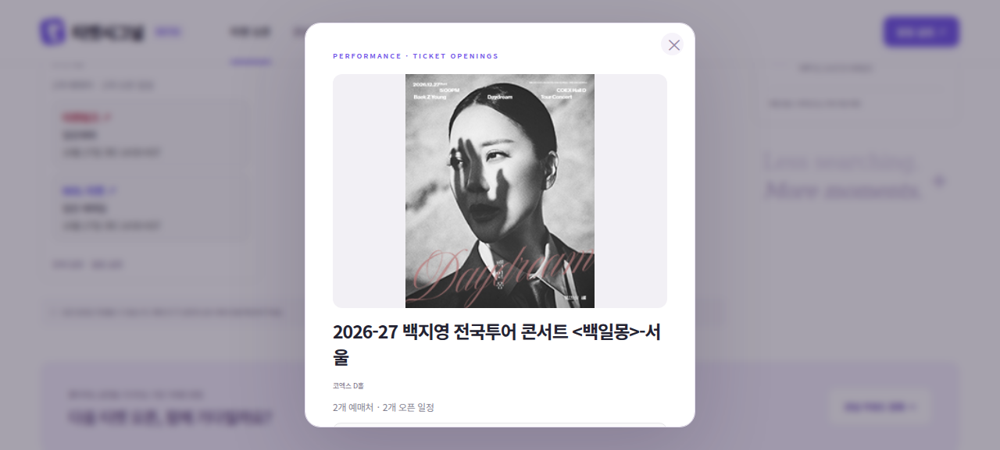
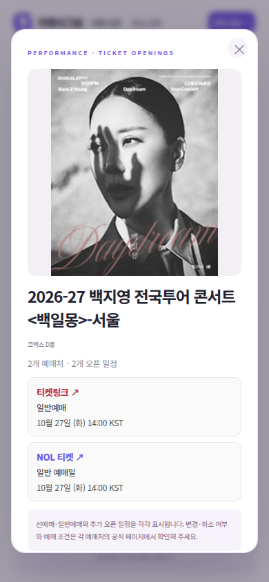

# 동일 공연 통합 · 예매처별 이동 검증

작업일: 2026-10-26. 범위는 제출 준비 순서의 2번이며, 3일 필터·정렬·실제 이메일 발송은 포함하지 않는다.

## 구현과 판별 기준

- 원본 오픈 일정은 삭제하지 않고 화면에서만 공연 단위로 묶는다.
- 같은 예매처의 같은 상세 URL·정규화 제목은 하나의 상품으로 묶고 판매 회차를 유지한다.
- 예매처 간에는 공지 접미사·공백·장식 기호를 제외한 제목과 겹치는 오픈 시각이 필요하다. 지역·연도·시즌 문구는 유지한다.
- 알려진 공연장·공연 기간이 충돌하거나, 정보가 없는 항목이 서로 다른 공연장을 연결하는 경우에는 통합하지 않는다.
- 모든 공연의 실제 공연 기간을 수집하는 것은 아니다. 제목이 크게 다르거나 확인 정보가 부족하면 중복 카드가 남을 수 있고, 기간 미상 항목의 동일 공연 판별에는 한계가 있다.
- 포스터·제목은 통합 상세를 연다. 카드와 상세의 예매처별 링크는 원본 개별 예매·공지 URL을 새 창으로 연다.
- 필터는 개별 일정에 적용하고, 상세에서는 그 공연의 모든 예매처 일정을 확인할 수 있다. 기존 즐겨찾기 ID도 인식한다.

## 실행 결과

데이터 기준: 기존 실제 수집 스냅샷 `server/initial-snapshot.json` (수집 시각 2026-10-24 07:32 KST). 아래 건수는 이 스냅샷의 재현 결과이며 새로운 수집 성공을 의미하지 않는다.

| 검증 | 절차 및 예상 결과 | 실제 결과 | 판정 |
|---|---|---|---|
| 전체 일정 보존 | 159개 원본 일정에 그룹 함수를 적용하고 그룹 안 일정의 총합 비교 | 121개 공연 카드, 그룹 내부 일정 합계 159개. 여러 예매처가 있는 카드 18개 | 통과 |
| 대표 공연 통합 | ‘백지영’ 검색. 서울 공연이 한 카드에 NOL·티켓링크를 표시해야 함 | 브라우저에서 1개 카드·2개 링크 확인. 모두 10월 27일 14:00 KST 표시 | 통과 |
| 회차 보존 | ‘엠. 버터플라이’ 검색. 두 예매처의 판매 회차를 유지해야 함 | 브라우저에서 1개 카드·4개 일정 링크 확인 | 통과 |
| 잘못된 통합 방지 | 테스트에서 지역·연도·공연장·공연 시작일·오픈 시각을 각각 다르게 입력 | 서로 다른 항목은 분리. 공연장 미상 항목이 서로 다른 공연장을 연결하는 사례도 분리 | 통과 |
| 필터와 즐겨찾기 | 백지영 검색 후 NOL 필터, 상세 열기, 관심 등록·해제 | 카드 링크 1개, 상세 링크 2개. 관심 수는 공연 1개로 표시하고 해제 시 관심 목록에서 제거 | 통과 |
| 모바일 | 390×844 화면에서 통합 상세 및 페이지 너비 확인 | 페이지·상세 가로 넘침 없음. 예매처와 날짜 표시 확인 | 통과 |

`npm test`: 26개 테스트 통과, 실패 0개. 이 중 신규 그룹 관련 테스트 6개. 브라우저 상호작용 확인 10개 통과, 자바스크립트 오류 목록 비어 있음.

## 화면 근거

## 대표 공식 링크

- NOL: https://nol.yanolja.com/ticket/products/26015376
- 티켓링크: https://www.ticketlink.co.kr/help/notice/66293

위 주소는 수집 데이터와 카드·상세의 href가 일치함을 확인했다. 외부 티켓링크 페이지를 별도 브라우저 탭으로 열었으나 본문 확인 과정에서 시간 초과가 발생했다. 따라서 이번 검증은 링크 URL·새 창 속성·화면 표시 확인까지이며, 모든 외부 사이트의 최종 페이지 로딩 성공을 주장하지 않는다.

## 작업 중 문제와 복구

브라우저 실행에 필요한 libnspr4·libnss3가 없어 첫 실행이 실패했다. 사용자 임시 폴더에 패키지를 풀고 새 브라우저 세션에 라이브러리 경로를 지정한 뒤 화면 검증을 완료했다. 이 조치는 개발 환경에만 적용했으며 서비스 코드에는 포함하지 않았다.
