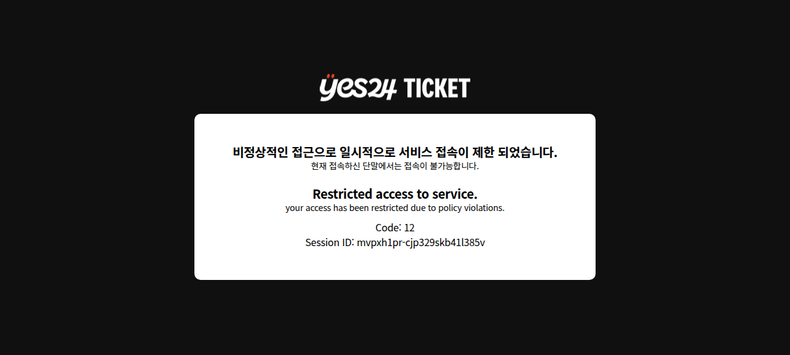
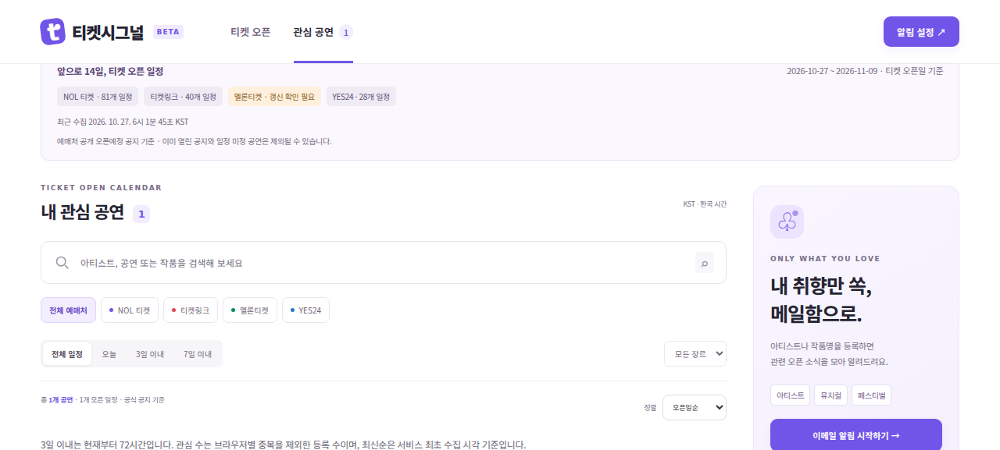
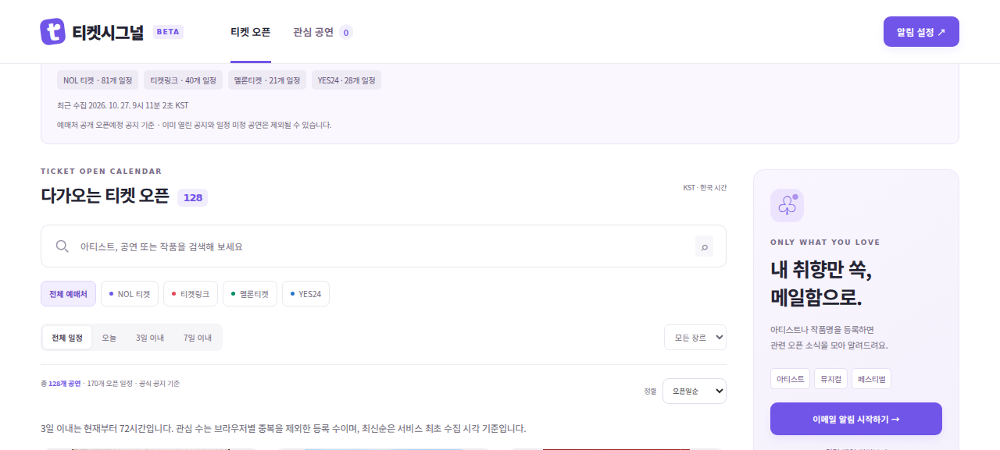

# 5번 · 배포 서비스 검증 (이메일 제외)

검증일: 2026-10-27 (KST). 대상: https://ticket-signal.kmu-mba-1095.chatgpt.site

이 기록은 운영 환경의 공개 API, 브라우저 화면, 사이트 예약 설정, 인증된 상태 조회 도구를 직접 확인한 결과다. 실제 이메일 발송·구독 서버 저장은 범위에서 제외했다.

## 최초 확인과 발견한 문제

- 14일 범위: 2026-10-27 00:00 이상 ~ 2026-11-10 00:00 미만, KST. 화면 표기는 10월 27일~11월 9일.
- 오픈 일정 166개: NOL 81, 티켓링크 40, 멜론 17, YES24 28. 범위 밖 일정 0개.
- 총 166개 링크가 예매처 홈페이지가 아닌 개별 상품·공지 URL 패턴임을 확인했다.
- 매일 06:00, Asia/Seoul 예약이 활성화되어 있고 데이터에 2026-10-27 06:01:45 KST 갱신 시각이 저장되어 있었다. 검사 전에 수동 갱신하지 않고 읽은 값이다.
- NOL·티켓링크·YES24는 해당 시각 수집 성공. 멜론은 `Melon pagination repeated` 오류로 전날의 정상 데이터를 유지했다. 화면도 멜론에 ‘갱신 확인 필요’를 표시했다.
- 소스 상태의 count는 마지막 수집 건수다. 날짜 필터를 거친 현재 화면 건수와 다를 수 있으므로 이번 검증은 API events의 실제 항목 수를 별도로 집계했다.

근거: [검사 전 API 요약 JSON](evidence/live-check-before.json).

## 멜론 오류 원인과 복구

실제 멜론 목록의 첫 번째 페이지와 다음 페이지에 `melon-13107` 공지가 겹쳐 나타났다. 기존 코드는 중복 한 건도 페이지 반복 오류로 처리해 해당 예매처의 전체 갱신을 중단했다.

중복 공지는 건너뛰고 새 공지를 계속 수집하도록 수정했다. 새 공지가 전혀 없는 전체 페이지가 반복되면 여전히 오류로 처리하므로, 잘못된 페이지네이션을 정상 결과로 숨기지 않는다. 겹치는 페이지와 전체 페이지 반복을 구분하는 회귀 테스트 2개를 추가했다. 전체 자동 테스트 35개 통과. 로컬 실제 수집에서 멜론 21개 일정, 스캔 35행, 중복 1행, 일시 미정 14건을 확인했다.

## 예매처별 대표 링크

| 예매처 | 공연 / 주소 | 실행 결과 |
|---|---|---|
| NOL | [뮤지컬 드라큘라 - 대구](https://nol.yanolja.com/ticket/products/26012217) | HTTP 200, 개별 상품 URL 유지, 페이지 제목과 본문에 해당 공연 확인 |
| 티켓링크 | [뮤지컬 80일간의 세계일주 - 부산](https://www.ticketlink.co.kr/product/66561) | HTTP 200, 개별 상품 URL 유지, 페이지 제목과 본문에 해당 공연 확인 |
| 멜론 | [임태경 When Heritage Meets Tomorrow](https://ticket.melon.com/csoon/detail.htm?csoonId=13127) | HTTP 200, 공지 번호 유지, 본문에 해당 공연 확인 |
| YES24 | [크리스마스 재즈 나잇](https://ticket.yes24.com/Notice#id=18723) | 공지 페이지 HTTP 200. 상세 공지 번호는 URL 해시로 전달된다. 자동 브라우저에서는 예매처 접속 차단 페이지로 이동해 상세 본문 확인은 미완료 |

전체 링크의 목적지 구조를 검사했고 대표 4건을 추가 확인했다. 모든 공연의 외부 상세 내용을 하나씩 대조한 것은 아니다. YES24는 일반 사용자 브라우저에서 추가 확인이 필요하며 자동화 차단을 우회하지 않았다.

## 관심 등록 저장

운영 브라우저에서 ‘뮤지컬 80일간의 세계일주 - 부산’을 관심 등록했다. 등록 성공을 기다린 뒤 페이지를 새로고침하고 데이터 로딩이 끝난 후 확인했다. 같은 브라우저의 하트 상태 true, 관심 공연 수 1, 관심 목록의 해당 공연 표시를 확인했다. 검증 후 관심 해제 성공(관심 수 0)까지 확인했다.

이는 관심 공연 저장 검증이다. 이메일 구독이 서버에 저장되거나 실제 메일이 발송되는 것을 검증한 것은 아니다.

## 자동 갱신 판정의 범위

예약 활성화와 06:01의 저장된 갱신 시각, 예매처별 성공·실패 기록을 확인했다. 다만 스케줄러 자체의 실행 ID·상세 실행 로그는 제공된 조회 결과에서 확보하지 못했으므로 정확한 시작 시각이나 앞으로 매일 반드시 성공한다는 보장은 하지 않는다. 이후 수동 복구 검증은 예약 실행과 구분해 기록한다.

## 복구 후 운영 검증 결과

2026-10-27 09:11:02 KST, 수정 배포 버전 6에서 인증된 소유자 갱신 도구를 수동 실행했다. 저장 후 별도 상태 조회와 공개 API를 다시 읽어 결과가 일치함을 확인했다.

| 확인 항목 | 결과 |
|---|---|
| 4개 예매처 상태 | 모두 `ok` |
| 실제 오픈 일정 | NOL 81 + 티켓링크 40 + 멜론 21 + YES24 28 = 170개 |
| 통합 화면 | 128개 공연 카드 · 170개 오픈 일정 |
| 14일 범위 밖 | 0개 |
| 멜론 중복 처리 | 중복 공지 1행 제외, 일시 미정 14건 제외 |
| 관심 검증 후 정리 | 테스트 브라우저 관심 공연 0개 확인 |
| 최초 수집 시각 저장 기능 | API `firstSeenAvailable: true` |

근거: [복구 후 API 요약 JSON](evidence/live-check-after.json). 복구 소스 커밋: `6989d5f49be91b5f61748e6fb5fcb8e61023bc80`.

확인된 범위에서는 14일 필터, 네 예매처의 수집·저장·조회 경로, 관심 등록·새로고침 유지·해제가 작동한다. YES24 상세 화면의 일반 브라우저 확인과 다음 예약 실행의 연속 성공 관찰은 남아 있다. 이메일 관련 검증은 수행하지 않았다.
