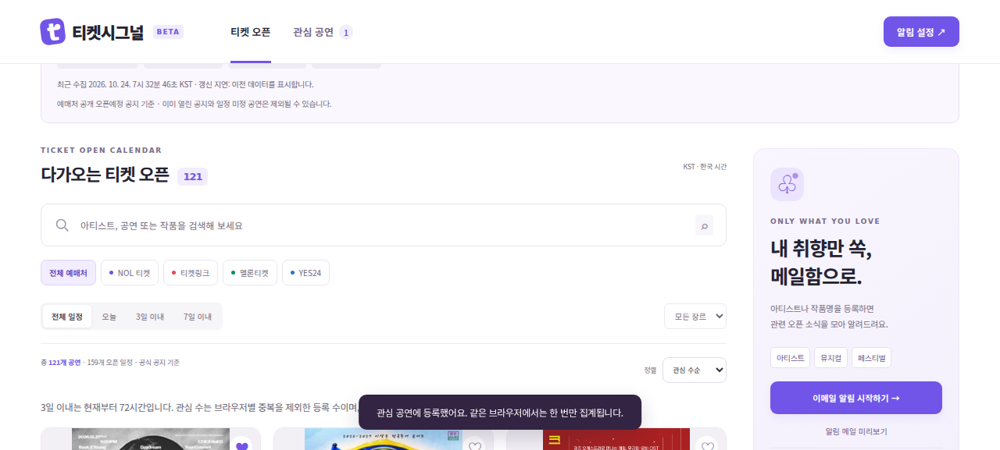
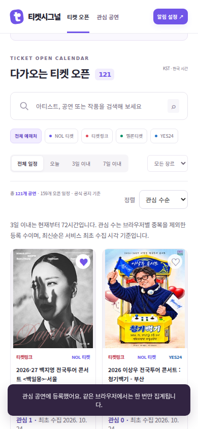

# 3일 필터 · 정렬 · 관심 집계 검증

작업일: 2026-10-26. 제출 준비 순서 3번 구현. 이메일 실제 발송은 이번 작업에 포함하지 않는다.

## 사용 기준

- 3일 이내: 현재 시각 이상, 현재 시각 +72시간 이하. 지난 오픈은 제외한다. 화면은 30초마다 필터를 다시 평가한다.
- 오픈일순: 현재 필터에 맞는 다음 오픈 시각이 가까운 공연부터. 이미 열린 일정만 있는 공연은 뒤에 배치한다.
- 관심 수순: 서버 D1에 저장한 익명 브라우저별 관심 등록 수가 높은 순서. 같은 브라우저가 반복 요청하거나 같은 공연의 여러 예매처를 등록해도 한 번으로 집계한다.
- 최신 등록순: 서비스가 해당 상품을 처음 수집한 시각의 내림차순. 같은 공연을 여러 예매처에서 수집한 경우 가장 이른 시각을 사용한다. 갱신이나 판매 회차 추가로 최초 시각을 덮어쓰지 않는다.
- 정렬 기준이 같으면 다음 오픈 시각과 식별자로 순서를 결정한다.

## 실제 저장과 한계

익명 브라우저 식별자는 서버가 쿠키로 발급하며 HttpOnly·SameSite=Lax, HTTPS에서는 Secure를 적용한다. 서버에는 브라우저 식별자와 예매처 상품 키를 저장한다. 관심 해제 및 개인정보 안내의 삭제 버튼으로 해당 브라우저의 등록을 삭제할 수 있다. 이메일·키워드는 여전히 브라우저 데모다.

로그인 계정 또는 고유 인원 수가 아니다. 브라우저를 바꾸거나 쿠키를 삭제하면 별개로 집계될 수 있으며, 동일인의 여러 브라우저나 조작을 완전히 막는 시스템은 아니다. 예매처 상품 키는 플랫폼+개별 URL로 구성하므로 URL이 바뀌면 최초 시각·관심 연결이 새로 시작할 수 있다. 현재 통합 그룹에 포함된 상품들의 관심을 합쳐 계산한다.

최초 시각 기능 도입 전의 데이터는 보존된 스냅샷 수집 시각(2026-10-24 07:32 KST)을 초기값으로 쓴다. 따라서 초기 공연들은 같은 등록 시각일 수 있으며 과거 개별 공지 등록 시각을 임의로 생성하지 않는다. 기존 로컬 관심 목록도 자동 업로드하지 않으므로 서버 관심 수에 포함되지 않는다.

## 검증 결과

| 검증 | 실행 및 근거 | 결과 |
|---|---|---|
| 72시간 경계 | 고정 현재 시각에서 -1ms, 0, +72h, +72h+1ms, 잘못된 날짜 입력 | 현재와 +72h만 포함 |
| 세 가지 정렬 | 서로 다른 오픈 시각·관심 수·최초 수집 시각을 가진 테스트 공연에 각 정렬 적용 | 오픈일 a→b→c, 관심 수 b→a→c, 최신순 c→a→b |
| 최초 시각 보존 | 실제 SQLite 마이그레이션을 적용하고 같은 URL에 새 판매 회차 ID·새 수집 시각 입력 | 기존 상품의 최초 시각 유지, 새 상품만 새 시각 저장 |
| 중복 집계 | 로컬 D1 서버 HTTP 요청으로 A 브라우저 등록·재등록, B 브라우저 등록 | 0→1→1→2 |
| 저장 유지·해제 | 같은 쿠키로 다시 조회하고 A 관심 해제 | 등록 복원 확인, 2→1. 재해제해도 감소 중복 없음(단위 테스트) |
| 요청 검증 | 외부 Origin과 존재하지 않는 공연 ID로 저장 요청 | 각각 403, 404 |
| 브라우저 필터 | 실제 수집 스냅샷 화면에서 3일 이내 선택 | 검사 시 89개 일정 모두 검사 시각부터 72시간 범위 내 |
| 브라우저 관심 정렬 | 백지영 공연 관심 등록 후 관심 수순 선택 | 관심 1 표시, 해당 공연이 첫 카드로 이동 |
| 모바일 | 390×844에서 필터·정렬·카드 표시 확인 | 가로 넘침 없음, 브라우저 자바스크립트 오류 없음 |

자동 테스트: `npm test` 33개 통과. HTTP 검사: `node tests/interest-http-check.mjs` 7개 통과. 브라우저 상호작용 검사 7개 통과 및 모바일 넘침 검사 통과. HTTP 검사와 화면 확인에 사용한 관심 등록은 로컬 DB에서 삭제했다. 아래 화면의 관심 1은 검증 중 실제 저장한 테스트 등록이며 운영 이용자 수가 아니다.

## 화면

## 다음 단계

4번은 이메일 알림을 실제 작동시키는 작업이다. Gmail 계정의 Google OAuth 인증, 서버 구독 저장, 오픈 24시간 전 발송 작업, 중복 발송 방지·구독 해지, 실제 수신 확인이 남아 있다.

## 리뷰 후 보완

최초 배포 후 자동 갱신이 먼저 실행되어도 이전 스냅샷의 최초 수집 시각을 보존하도록 보완했다. DB 장애 시에도 기존 공연 목록을 표시하고, 관심 수·최신순 중 사용할 수 없는 정렬만 오픈일순으로 대체한다. 두 회귀 테스트를 추가해 33개 자동 테스트가 통과했다.

## 공개 운영 서버 확인 — 2026-10-27

배포 버전 5가 성공한 후 공개 서비스에서 `interest-http-check.mjs`의 7개 검증을 모두 통과했다. 검증용 두 브라우저의 관심 등록·반복 등록·해제, 동일 쿠키 재조회, 외부 Origin 거부, 없는 공연 거부를 확인했다. 검증용 등록은 DELETE 요청으로 정리했다.

운영 서버의 최초 수집 시각 초기값은 운영 R2에 보존된 스냅샷 기준이다. 위 10월 24일 값은 로컬 검증에 사용한 스냅샷이며, 운영 데이터는 자동 갱신 상태에 따라 다른 최초 관측 시각을 가질 수 있다. 개별 상품의 도입 전 전체 수집 이력을 복원한 것은 아니다.

- 서비스: https://ticket-signal.kmu-mba-1095.chatgpt.site
- 배포 소스 커밋: `a6b3569ebf6616f0793a4df19e5dba6e8843c9ba`
